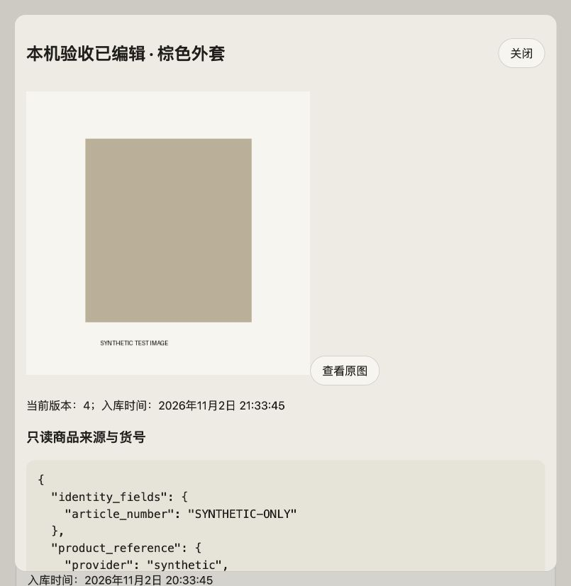
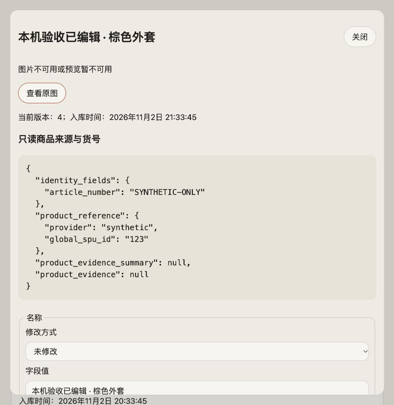

# 衣橱后台：原图回退修复与复验（2026-11-02）

结论：**原图回退缺陷 F1 已修复并通过本机复验**。此前完整验收未通过记录中的该功能缺陷已关闭；Linux 缩略图生成、390px 手机视口、systemd／跨 UID 和生产 TLS 等未验部分仍保留，不能据此宣称后台整体生产验收完成。

## 范围与候选

用户在本机验收后明确指令“修复”。本轮仅处理已复现的既有功能缺陷及回归，未增加新功能／数据域，适用既有修复范围，无须新 PRD 或技术方案。本机合成数据服务及上轮环境保持。

- Homepage：`feat/wardrobe-admin`，Base `1add56c358dfe0ab6daf8687384c77aa8619945a` 加当前未提交修复。
- Wardrobe API：`f29ca9d63c0e5ea0b3ef9eaeee49785b584e2e53`，业务代码未变。
- 修复后 `ops/wardrobe-admin/ui/admin.js` SHA256：`7bd47cb0e5de96b32ad2ed2eff40208a20667d86d0afe006fd3e954eaeef8644`。
- 回归 `test/wardrobe-admin-ui.test.mjs` SHA256：`8bfdf0859330652121059096ef7f00d54762aa3ab67f208e408532e87cc63f28`。
- 保留上一轮验收文档／截图和原主工作区修改；未提交、推送、PR、合并或部署。

## 变更

原错误处理用新的段落替换 img，“查看原图”随后仅修改已脱离文档的 img.src。现在保留同一个错误占位节点，查看原图时先将 img 重新挂载，再设置原图地址；原图再次报错时仍可循环显示错误并手动重试。没有自动原图下载、改图、上传或权限变化。

Node 最小 DOM 夹具补齐节点归属和 replaceWith 行为，用实际 UI 模块覆盖预览成功／失败、切换原图、原图失败及再次重试。新增两个用例在修复前均失败（旧交互用例仍通过），修复后全部通过；断言关注可见节点归属与错误恢复，另由真实浏览器证明图片成功解码。

## 当前验证

| 检查 | 本轮结果 |
| --- | --- |
| `node test/wardrobe-admin-ui.test.mjs` | 3 通过／0 失败 |
| `npm run build` | 成功，51 页 |
| `node test/ac-checks.mjs` | 150 通过／0 失败 |
| `git diff --check` | 通过 |
| 原预览 503 → 点击查看原图 | 页面显示 480px 原图，complete=true，错误占位消失 |
| 已读详情后暂时移走合成原图 → 点击查看原图 | 显示错误，img 数为 0，原图按钮可用 |
| 归还同一合成原图 → 同一详情再次点击 | 重新显示 480px 原图，complete=true，无需重开详情 |

真实浏览器通过与前轮相同的 Nginx→Unix socket→TCP API 路径复验。只有 `/tmp/wardrobe-admin-acceptance-20261102` 内的合成色块原图被临时移走并归还；已确认没有文件残留在 held 状态，SQLite 和真实照片未改。没有为通过测试放开非 Linux worker，也没有生成预览缓存。后端／代理未变，不重复运行前轮已通过的 187 项 operator 和 27 项代理测试。

预览失败后原图正常显示：

原图不可用时保留重试入口：

原图恢复后，在同一详情重新显示：

本机入口仍为 `http://localhost:18765/wardrobe-admin/`，合成账号／密码保持上一轮。修复后的 JS 由现有代理按请求读取，浏览器已刷新并核验，无需重启后端。此前环境边界和生产部署限制见[首轮报告](wardrobe-admin-mac-2026-11-02.md)。
