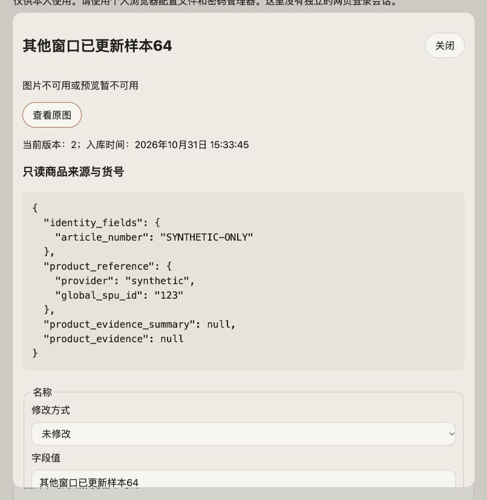
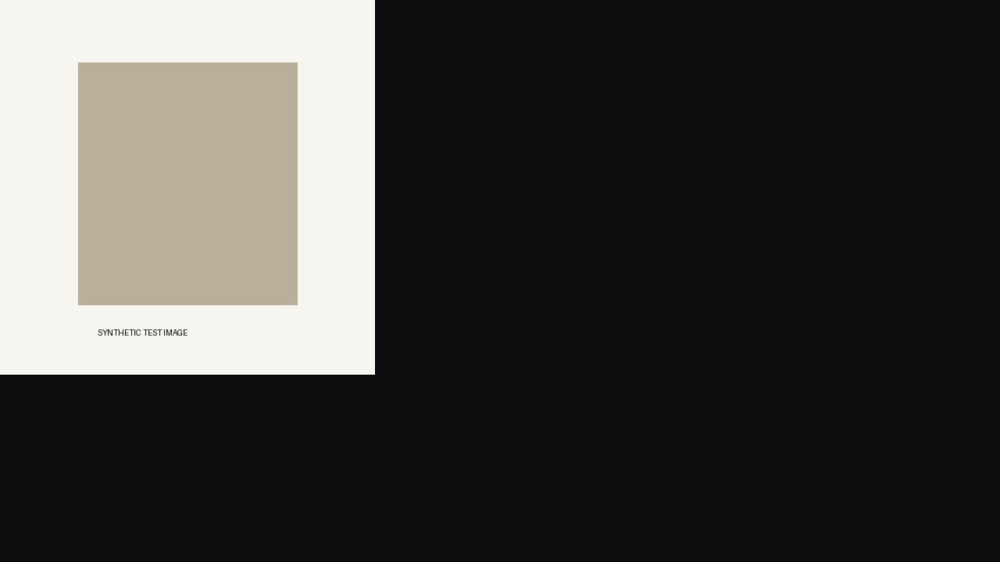
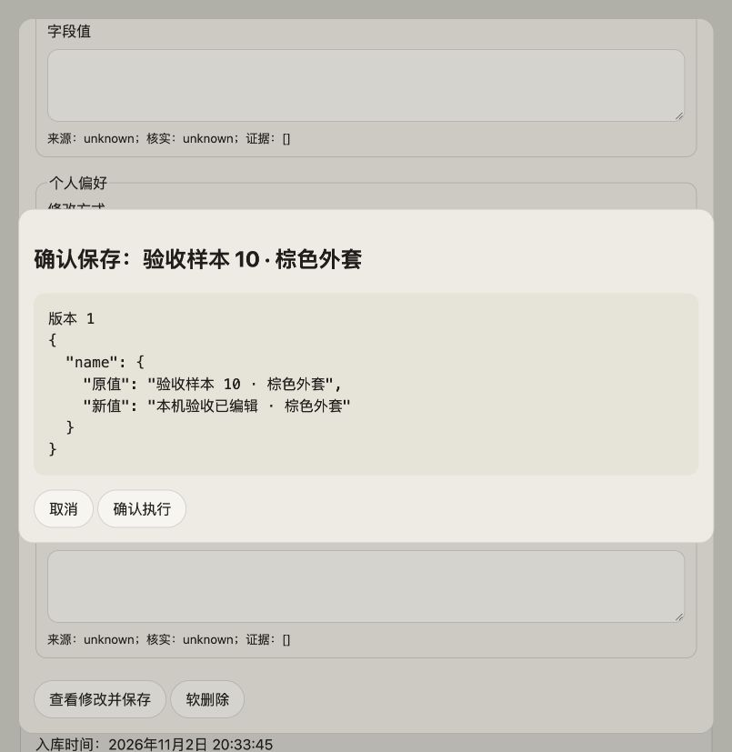
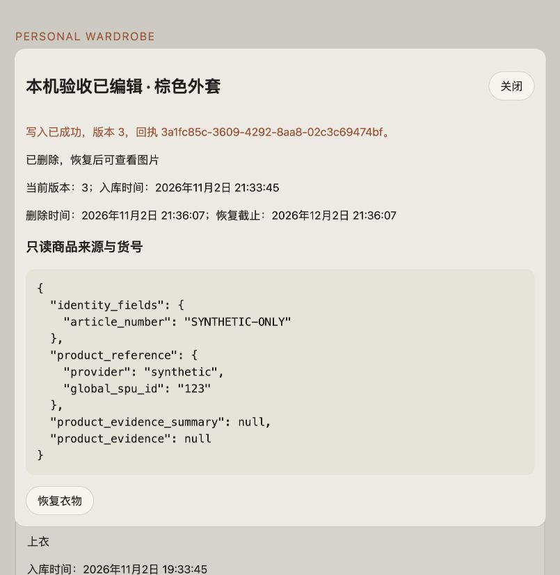
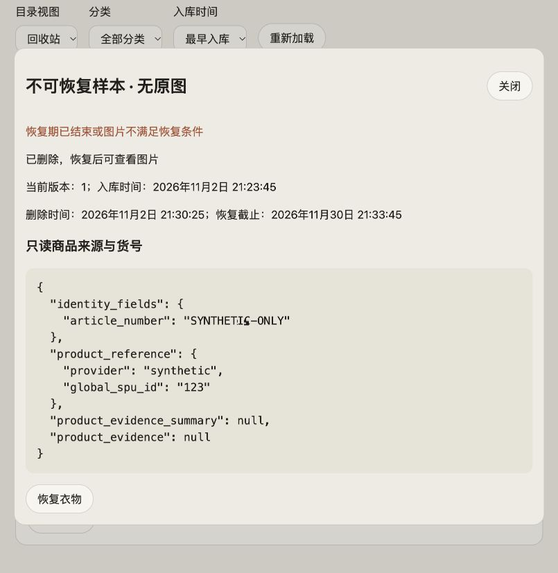
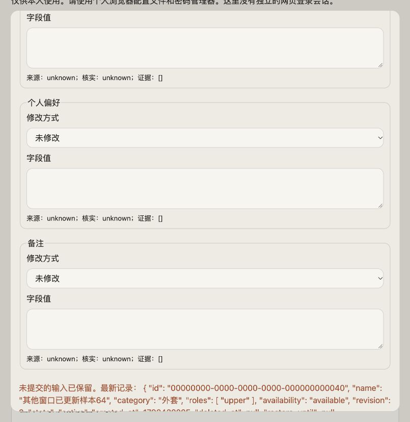
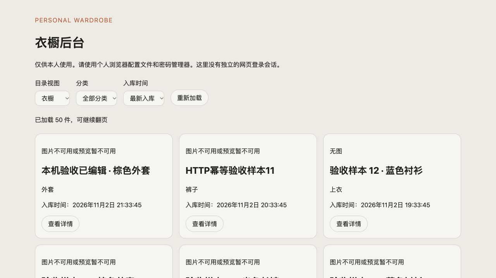

# 衣橱管理后台：Mac 本机联调验收（2026-11-02）

> 后续状态：用户已授权修复，F1 原图回退已修复并通过真实浏览器复验。见[修复报告](wardrobe-admin-image-fallback-fix-2026-11-02.md)。下文保留首轮验收的原始失败事实与截图；未验环境项仍未关闭。

结论：**暂不通过完整验收**。核心读写链路已实际跑通，但预览失败后的“查看原图”有可重复的功能缺陷；Mac 缩略图生成及完整生产环境验收仍有限制。本次是验收与记录，没有修改业务代码或修复缺陷。

## 候选与范围

| 对象 | 固定提交 |
| --- | --- |
| Homepage `feat/wardrobe-admin` | `1add56c358dfe0ab6daf8687384c77aa8619945a` |
| Wardrobe `feat/wardrobe-admin` | `f29ca9d63c0e5ea0b3ef9eaeee49785b584e2e53` |

使用两份独立 worktree、临时 SQLite、55 件 active 合成衣物、2 件恢复期内 deleted 合成衣物、1 件过期样本和 3 张合成色块图片。未读取生产凭据、生产数据库或真实照片，没有外部模型／供应商调用，没有生产部署、Git 提交／推送或 PR。

真实路径：浏览器 → 本机 Nginx（Basic Auth）→ Unix socket 原代理 → loopback TCP FastAPI → 临时 SQLite／合成图片。临时根目录为 `/tmp/wardrobe-admin-acceptance-20261102`，包含启动脚本、临时配置与原始日志；凭据／数据库没有复制到仓库。

## 已确认的功能缺陷

### F1：预览失败后，查看原图操作不显示图片（需修复后重验）

复现步骤：

1. 打开有关联原图的衣物详情，使预览请求失败（本机返回 503 `PREVIEW_UNAVAILABLE`）。
2. 页面显示“图片不可用或预览暂不可用”，点击“查看原图”。
3. 页面仍没有图，DOM 中 `#record img` 数量为 0；直接打开同一原图 URL，浏览器正常显示 PNG，接口返回 200。

代码定位：`ops/wardrobe-admin/ui/admin.js:64` 在 error 时以段落替换并移除原 `img`；`:69` 点击原图只修改这个已脱离 DOM 的旧节点的 src，没有重新挂载。该缺陷也会影响 Linux 上临时预览失败／繁忙后的恢复操作，并非仅由 Mac 平台导致。

修复方向：原图操作须重建或重新挂载可见图片，同时清理错误占位；补充“预览失败 → 原图成功”和“原图仍失败”的真实 DOM 回归。当前验收未实施修复。

后台点击原图后仍无图：

直接访问同一原图可正常显示：

## 已通过的真实操作

1. **列表与分页**：第一页 50 件，继续翻页后共 55 件且名称去重数 55；“当前查询已读完”与临时库一致。
2. **筛选与排序**：外套分类 19 件；最早入库顺序从样本 64 到样本 10，与造数时间相符。
3. **单件编辑**：修改样本 10 名称，弹窗先展示目标、版本及旧／新值；确认后版本 1→2 并返回回执。
4. **软删除与恢复**：同一件衣物版本 2→3→4，删除期限为精确 30 天；恢复后 SQLite 为 active，删除时间和恢复期限清空。
5. **回收站**：只显示 2 件期限内样本，过期样本不出现；缺原图样本恢复被拒绝，state=deleted、revision=1 保持。
6. **并发冲突**：详情停在版本 1 时，经独立 HTTP 修改样本 64 至版本 2；旧 UI 保存返回冲突，保留“冲突前保留的用户输入”，禁用保存并提供对照最新版本入口，没有覆盖对方修改。
7. **鉴权与 CSRF**：未认证时后台入口／页面／脚本／session／详情／未知路径均 401；错误 Origin、缺 CSRF 和 cross-site 请求均拒绝且不写库。
8. **幂等与持久化**：同 key／同正文重放得到同一 receipt，只递增一次；同 key／异正文 409。原图经完整 Nginx→Unix→TCP 路径返回 200。

修改前确认：

删除成功，显示版本、回执和恢复期限：

回收站缺原图恢复被拒绝：

并发冲突保留输入（截图显示冲突提示开头；完整新记录为较长 JSON）：

SQLite 独立回读：完成编辑／软删／恢复后，样本 10 为 active／revision 4，3 个审计事件与 3 条幂等记录，human_decisions=0，符合运营者直写例外；后续冲突与 HTTP 幂等检查另增加 2 个成功操作。schema head 始终为 `0010_agent_facade`。

## 当前运行的检查

| 检查 | 结果 |
| --- | --- |
| Python 3.12：三个 operator 测试模块 | 187 项通过 |
| Python 3.12：Homepage `wardrobe_admin_test.py` | 27 项全部通过，含真实 Unix socket，无跳过 |
| Node：`wardrobe-admin-ui.test.mjs` | 1 项通过 |
| `npm ci`、`npm run build` | 成功，51 页 |
| `node test/ac-checks.mjs` | 150 通过／0 失败，含私有后台不进入公开 dist 的隔离检查 |
| 真实 Nginx 合成合同脚本（Mac 哈希适配） | 认证／安全头／固定代理头／换密／限流／移除入口全部通过 |
| 本轮真实 API+代理 HTTP 检查 | 15 个断言通过 |
| 两仓 `git diff --check` | 通过 |

未重复运行全量衣橱测试或 analytics 全量回归；业务源码没有变化。既有全量记录不能替代本次实际浏览器证据。

## 页面与可访问性观察

1280×720 下为 3 列，805×827 下为 1 列；两种视口页面均无横向溢出，805 下详情也无横向溢出。确认弹窗默认焦点在取消按钮；字段有 legend／label，状态区声明 aria-live。未完成屏幕阅读器、完整键盘旅程和 390px 手机视口验证，不宣称无障碍或手机验收完成。

可用性改进项（非额外验收阻断）：40 个编辑字段展开后很长，操作按钮位于底部；冲突对照输出完整 JSON，难以快速比较有变化的字段。建议后续采用字段分组／固定操作区及字段级差异视图，不在本轮验收中更改设计。

## 环境差异与证据边界

- macOS 自带 Python 3.9.6 在空 query + strict parse 行为上产生 5 项失败；改用项目 Python 3.12.14 后 27 项全部通过。代理业务代码没有改动。生产 unit 使用 `/usr/bin/python3`，部署前必须核验实际版本。
- 缩略图子进程 `src/personal_wardrobe/preview_worker.py::main` 明确在非 Linux 返回 exit 2。本机原图有效、预览返回 503；没有绕过此保护，也没有伪造预生成缓存来计作通过。Linux 受限缩略图生成仍需单独执行。
- 本机安装了 Homebrew Nginx 1.31.8，Homebrew 同时更新了 OpenSSL、CA certificates 和 PCRE2 依赖；未使用 `brew services`，未注册开机服务。只加载 `/tmp` 下隔离配置并绑定 loopback 18765。
- 原 Nginx 测试脚本使用 SHA-512 crypt，Mac 上正确密码仍得到 401；只在临时测试包装中将合成密码哈希改为 APR1 后通过，仓库脚本未改。Linux 原哈希行为仍待生产型环境核验。
- 浏览器联调在临时进程内把代理 ORIGIN 改为 `http://localhost:18765`；源码仍严格绑定 `https://zhuyawei.com`。cookie 名称、Secure／HttpOnly／SameSite 和 CSRF 算法保留。HTTPX 对 HTTP 地址不自动发送 Secure cookie，HTTP 合同脚本显式带合成 cookie；浏览器实际写入使用其正常 cookie 行为。由此不宣称公网 TLS 已验收。
- 一次原图诊断的 HTTPX 请求未设置 trust_env=False，误经本机环境代理并收到远端 Nginx 308；只带合成 token，未跟随重定向，未读取生产数据。随后所有 HTTPX 联调均显式禁用环境代理；应用原代理使用 HTTPConnection，本身不读取环境代理。此误路由不计作本机验证证据。
- 浏览器联调临时限流为 600r/m，避免重复验收动作触发速率限制；原 60r/m 与强限流实际拦截另由独立真实 Nginx 脚本验证。
- macOS 不提供 Linux systemd；独立 UID、生产文件权限、真实 Nginx vhost／TLS／共享 analytics 凭据、ECS 资源与安装回滚均未验证。

## 本机继续查看

入口：`http://localhost:18765/wardrobe-admin/`。合成账号 `local-test`，合成密码 `local-test-only`；仅用于本机临时样本，没有生产权限。Nginx 只监听 127.0.0.1:18765，API 只监听 127.0.0.1:18766。

临时启动脚本 `serve.py` 运行原候选源码，`configure.py` 生成本地 Nginx 配置，`http_checks.py` 保存真实 HTTP 断言；均在上述临时根目录。当前服务保留供 Henson 查看，未触发真实衣物操作。本报告记录的是本轮验收事实，不代表用户已接受或已授权修复／部署。
